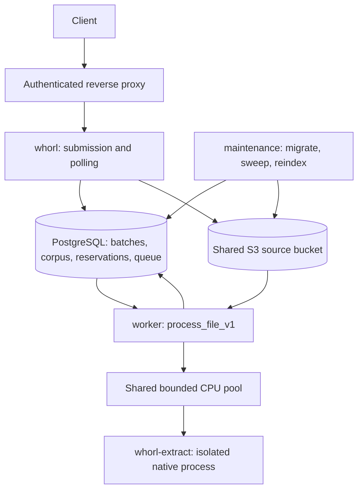

# Architecture and code map

Whorl is a Rust application with an HTTP intake/polling process, an independent durable worker, a supervised extraction child, and an operator-run maintenance command. PostgreSQL stores authoritative state and queue jobs. A shared S3-compatible bucket stores uploaded source bytes. There is no frontend or embedded authentication provider.

## Processes and durable flow

1. The proxy authenticates a client, strips/replaces `X-Client-Id`, and forwards to an API port inaccessible to public clients. Whorl scopes batches, corpus queries, quotas, and results to that identity. A header by itself is not authentication.
2. `AdmissionLease` reserves five attempts and 100 MiB before reading the body. PostgreSQL serializes global/client checks. Missing quota rows fail closed. Reservations are shared across replicas.
3. HTTP parses repeated multipart `files` parts with raw, per-file, combined, count, header, and time limits. `UploadStore` transfers allowances into journaled uploads and writes bounded S3 parts. Oversized files stop being stored but their remaining bytes are counted; valid siblings can continue.
4. One database transaction inserts the batch and ordered files, validates exclusively owned stored uploads, and enqueues eligible file jobs. Only after commit does HTTP return 202. All-invalid batches are durably terminal without queue work. An ambiguous submission retry can create another batch; there is no request replay key.
5. The worker claims a file using an advisory transaction lock and increments its attempt generation. It retrieves source bytes, runs supervised extraction, prepares canonical text/signatures, retrieves candidates, and verifies them exactly. Named stages are persisted for polling.
6. A final transaction verifies attempt ownership and deadline, writes matches, optionally ingests a canonical document, completes the file, and aggregates terminal batch state. Queue acknowledgment follows processing. Repeated terminal delivery does not recompute results.
7. Polling streams persisted results from one repeatable-read snapshot. It does not wait for extraction or enter the CPU pool. Maintenance later expires results, tombstones, jobs, abandoned reservations, and source objects under their ownership rules.

## Source structure and ownership

| Path | Responsibility |
| --- | --- |
| `src/main.rs` | HTTP startup, shared database/storage/queue state, route registration |
| `src/http/submit.rs` | Streaming multipart intake, limits, cancellation cleanup, admission invocation |
| `src/http/status.rs`, `health.rs`, `errors.rs` | Snapshot polling, conditional responses, dependency health, error mapping |
| `src/bin/worker.rs` | Queue runtime, worker concurrency/recovery settings, telemetry and source cleanup loop |
| `src/service/process_file.rs` | Durable attempts, stages, extraction-to-matching orchestration, retries, result commit, batch completion |
| `src/service/admission.rs` | Client/global reservation, staged-upload validation, atomic attachment/enqueue, and unused-budget release |
| `src/service/lifecycle.rs` | Shared terminal aggregation, validated retention, and bounded deadline recovery |
| `src/service/matching.rs` | Prepared documents, snapshot candidate retrieval, exact verification, canonical ingest entry point |
| `src/persistence/documents.rs`, `database/queries/` | Client-scoped SQL for canonical ingestion and candidate retrieval |
| `src/persistence/mod.rs` | Signed/unsigned persisted hash conversion helpers, included by schema tests |
| `src/similarity/` | Pure normalization, shingles, deterministic signatures/bands, metadata tokens, scoring |
| `src/cpu_pool.rs` | Dedicated Rayon pool, bounded admission, cancellation, deadlines, draining |
| `src/extraction/` | Format detection, Office/native extraction, limits, subprocess supervision |
| `src/bin/whorl-extract.rs` | Private extraction protocol executable |
| `src/storage/mod.rs`, `s3.rs` | Upload journal/accounting, multipart writes, deletion/reconciliation, S3 connection |
| `src/queue/` | Stable identifier-only payload, transactional graphile_worker enqueue and task dispatch |
| `src/bin/maintenance.rs`, `src/service/maintenance.rs` | Migration command, bounded sweep, version registration and reindex pages |
| `src/config.rs`, `src/telemetry.rs` | Startup settings/local dotenv and bounded JSON telemetry |
| `database/migrations/`, `database/queries/` | Application schema, upload journal, and candidate SQL; queue schema belongs to graphile_worker |
| `docker/extraction.Dockerfile` | Extraction runtime, verification, and acceptance images, built with the repository root as context |
| `tests/fixtures/` | SQL assertions and deterministic signature vectors |
| `tests/`, `benches/` | Deterministic, database, storage, worker and HTTP tests; CPU microbenchmarks |
| `spikes/`, `scripts/`, `.github/` | Research evidence/fixtures, reproduction tools, and CI/release automation |

`src/lib.rs` exports reusable processing modules. HTTP belongs to the `whorl` executable; maintenance includes its implementation directly. Configuration and telemetry are shared using explicit Rust path modules. File layout does not imply that every file is a separately replaceable adapter.

## State and identity

A batch is a submission with one immutable mode, signature snapshot, scoring policy, client, deadline, and revision. Each file has its own stage, attempt, source reference, error, and terminal outcome. A batch becomes `completed`, `partially_failed`, or `failed` only once all files are terminal. Polling revisions advance transactionally when relevant records change.

Canonical documents are unique by client and normalized-text SHA-256 hash. Their first successful ingest fixes canonical metadata, type, and creation time. Duplicate uploads retain separate provenance in file records while sharing the canonical document ID. Checks write batch results but do not modify the corpus. Ingests compare before inserting themselves. Siblings can see previously committed ingests; there is no promised batch ordering or batch-wide corpus snapshot.

Signatures are separate document/version rows. Long texts carry 125 values and 25 bands; short texts retain version membership with null arrays. Client identity and full signature version constrain lookup. See [similarity](similarity.md) and [persistence](persistence.md).

## Transactions, seams, and recovery

PostgreSQL and S3 have no shared atomic commit. The storage adapter journals each source and retains capacity until successful cleanup. A shared object-key advisory-lock convention protects attachment against reconciliation. The admission module owns that protocol, upload validation, and batch/job persistence; HTTP calls it through its request lease. File references in queued/running state protect sources even after nominal upload expiration.

Queue delivery is at least once. The queue job key deduplicates pending delivery, while application advisory locks and attempt fences protect durable side effects. Connection loss can release a lock while CPU work is still running; generation checks reject stale writes. Cancellation cannot forcibly kill a Rust thread. CPU work retains its slot until it exits, and native extraction uses a process group with timeout/resource controls.

Results expire 24 hours after terminal completion; an owner-visible tombstone remains for another 24 hours. Canonical corpus retention is independent. An exhausted infrastructure retry may remain unfinished if a database outage prevents recording its terminal failure. Operators must inspect durable file state and queue exhaustion after recovery. See [worker](worker.md) and [maintenance](maintenance.md).

`PreparedDocument::ingest` only writes canonical corpus content and version membership inside the caller's transaction. The worker owns fenced file completion. Admission, processing, and maintenance share terminal aggregation and retention through `service::lifecycle`. Signature recipes and persisted arrays are shared by preparation and reindexing. See the [architecture review resolutions](architecture-review.md).

## Resource model and limits

The target deployment has two cores and 4 GiB RAM. Worker handler concurrency equals the one/two-thread CPU pool, with zero waiting CPU slots. Extraction supervision, preparation, verification, and sorting use that pool. Maintenance reindexing runs one blocking computation at a time; its resource consumption must be included when scheduling alongside workers.

Streaming bounds request and candidate-page memory, not total workload. Candidate pages hold 32 records, but the matcher retains every qualifying score before persistence. Polling fetches 128 results at a time. Common metadata tokens can make weighted candidate retrieval expensive. Telemetry snapshots scan retained state under a timeout. None of these behaviors establishes a production corpus or arrival-rate limit.

Read [configuration](configuration.md) for exact runtime defaults, [extraction](extraction.md) for process limits, and [benchmarks](benchmarks.md) for measured workloads. The [architecture review](architecture-review.md) separates current correctness issues from optional deepening work.
